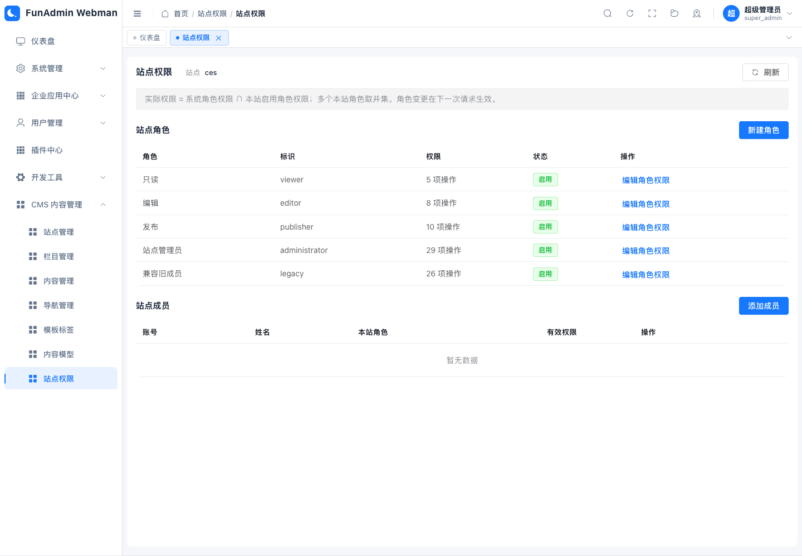
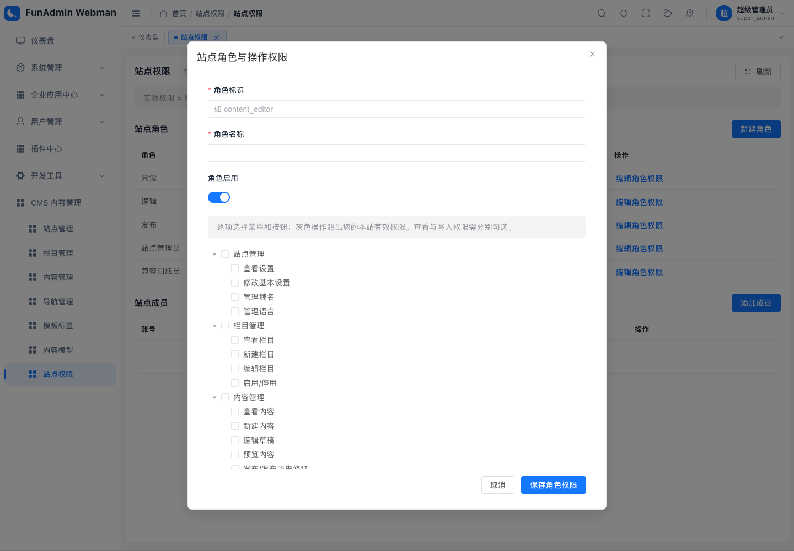
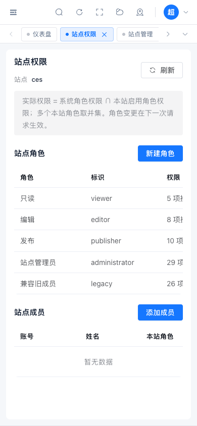

# CMS 1.1.0 菜单与站点权限验收

日期：2026-11-05。分支：Rbac。变更保留在当前工作区，未提交、合并或推送；保留其他会话的修改及共享暂存区。

## 已交付

- CMS 父目录下七个真实子菜单和独立页面：站点、栏目、内容、导航、模板标签、内容模型、站点权限。旧 `/admin/plugin/cms/manage` 自动跳转至第一个可访问页面。
- 29 项站点操作权限、5 个预置角色（含一次性升级兼容角色）、自定义角色、成员多角色分配、权限树及系统资格缺失提示。
- 普通账号：本站启用角色权限并集与宿主资格取交集。跨站并集只用于发现菜单；每个 API 使用当前站点校验。超级管理员保留宿主绕过规则。
- 新建/编辑按实际记录及自然键分类，启停独立检查；内容历史发布无需编辑权限。栏目及导航提供独立启停接口。
- 授权写入检查宿主管理范围、本人/共享角色影响、权限上限，记录授权审计。撤权下一请求生效。
- `002_site_roles.sql` 为新增迁移，保留原 `001_cms.sql`。缺少新表时返回升级提示，普通账号的 CMS 发现权限缺省拒绝，宿主核心恢复入口可用。

## 自动验证

| 检查 | 实际结果 |
| --- | --- |
| CMS + 宿主授权/菜单/SDK/Hook 相关 PHPUnit | 149 tests，537 assertions，无失败；3 项 MySQL 用例在默认 SQLite 运行中跳过 |
| 隔离 MySQL SQL001+002 DDL | 1 test，5 assertions，通过 |
| 隔离 MySQL 旧站点/已发布内容/系统授权升级与幂等性 | 1 test，12 assertions，通过 |
| 隔离 MySQL 站点锁与角色、菜单 API 并发写入 | 1 test，20 assertions，通过 |
| CMS Vue/Vitest | 23 tests / 7 files，通过 |
| 源插件 + 已发布前端源码 `vue-tsc` | 通过 |
| 8 个页面入口生产编译（含旧地址入口） | 通过 |
| `php webman plugin:validate cms` | valid=true，version=1.1.0 |
| `git diff --check` | 通过 |

后端命令：`TEST_MYSQL=0 php vendor/bin/phpunit tests/Cms tests/AuthorizationIntegrationTest.php tests/MenuHierarchyIntegrationTest.php tests/Console/PluginSdkRuntimeTest.php tests/PluginHookManifestTest.php tests/PluginHookRuntimeTest.php`（在 admin 下，等价于执行日志中的仓库根路径命令）。

前端命令：`npx vitest run tests/cms --reporter=dot`、`node scripts/check-cms.mjs`、`node scripts/build-cms.mjs`（在 web 下）。

MySQL 每项使用随机 `funadmin_cms_test_<hex>` 数据库，执行后删除；未借用开发库进行测试迁移。升级测试核对已发布内容/路由与宿主 Casbin 授权原样保留，重复升级不会恢复被撤销的角色成员。

测试包含真实 BrowserAuthService 会话、宿主插件授权中间件及 CSRF；覆盖内容账号仅有内容系统资格时的最小上下文、A 在站点1编辑/站点2只读、B 仅站点2发布、跨站 ID、创建/编辑/启停绕过、发布与下架拒绝、角色撤销、表缺失、宿主上下级及共享角色授权边界。

## 独立审查

一次独立只读审查未发现 Critical，提出四项 Important，均已修复并验证：

1. 权限分类与写入统一置于站点锁事务内；MySQL 菜单 API 等锁用例先失败后通过。
2. 首次绑定新模型按隐式默认值分别检查启停/模板权限；独立启停回归先失败后通过。
3. 旧 `sites/grant` 验证账号并在同事务记录完整授权前后审计；回归先失败后通过。
4. 历史版本入口脱离内容编辑抽屉；仅查看+发布角色的前端回归先失败后通过。

另修复插件目录登记为 M/Layout 的通用菜单元信息，回归先失败后通过。审查未提出需要延期的实质性 Minor。修复由实现者测试验证，没有额外重复派发审查。

## 本地已安装环境

通过正式 `PluginService::disablePlugin → updatePlugin(cms,true) → enablePlugin` 执行升级，随后 `php start.php reload`。最终前端样式调整通过正常资源发布器同步，未手改资源登记哈希。

- 版本 1.1.0，db_version=002_site_roles，enabled，migration_pending=0。
- 数据库有 1 个 CMS 父目录和 7 个启用子菜单。
- 既有站点 `ces` 保留。对升级前后 17 个旧 CMS 表及 `casbin_rule` 共 18 个表逐行规范化计算哈希，完全一致。
- 当前预置站点角色 5 个；未给真实账号新增站点角色或系统资格。
- `PluginModificationDetector::create()->isModified('cms') === false`。
- 未登录直接请求 `/admin/plugin/cms/context` 返回 401。
- 使用时刷新后台，打开 `/#/admin/plugin/cms/access`，在当前站点中维护角色和成员。

## 浏览器渲染

原桌面浏览器自动化连接不可用（无窗口/访问主机不可用），因此使用独立无头 Edge、当前 Vite 页面及只读的已安装后端服务响应快照进行渲染检查。快照模式没有复用用户 Cookie、没有绕过真实服务的登录会话去执行写请求，也没有修改真实账号授权；它验证界面接线与布局，真实登录/权限边界由上面的会话/API 测试覆盖。

渲染检查确认七个侧栏子菜单、七个独立页面、36 个权限树节点（7 组 + 29 项操作）、旧地址跳转、1440px 桌面及 390px 手机布局，无页面脚本异常。角色表在窄屏使用表格横向滚动。

## 仓库全量检查的既有问题

本轮执行过全量检查，不能宣称全仓通过：

- 后端当次运行 859 tests / 6431 assertions，5 errors、3 failures、109 skipped。错误为 AiProfileImageConsumerTest 的私有文件链接、CoreDatabaseAuditTest 与三个 CoreMigrationSourceTest 的权威根 SQL 路径问题；失败包括 AdminRouteInventoryTest 的 authorization 摘要、LoadLangPackContractTest 的既有 ThinkPHP 引用，以及 CMS 分组 use 语句被 BusinessModuleLayoutTest 扫描器误识别。
- CMS 发布前已改用逐行 app use 导入。发布后单独复测 BusinessModuleLayoutTest 已通过；与 AdminRouteInventoryTest 合并复测 56 tests / 2125 assertions，仅原 authorization 摘要失败。
- 前端当次全量 158 files：61 failed / 97 passed；964 tests：100 failed / 864 passed。包含旧目录引用、缺失夹具脚本与其他模块已有断言，未将其作为本轮 CMS 功能完成依据。

完整执行日志保留在 `.superpowers/sdd/2026-11-05-cms-site-menu-permissions/`；本轮相关检查及隔离 MySQL 结果以上表为准。

## 实施裁定

1. 保留当前 Rbac 及按路径隔离修改，避免丢失共享框架依赖；不触碰共享提交/暂存状态。代价是并行修改风险，以源/已发布一致性和最终检查约束。
2. 最小上下文使用 PluginPermission 的宿主资格 OR 列表，再按请求菜单过滤本站权限。内容账号无需站点设置资格；风险由最小字段投影和本站检查约束。
3. CMS 测试加载器优先源包，防止已安装旧类掩盖源代码回归。代价是过去被遮蔽的源问题会显现，应当被测试发现。
4. 本轮只实现站点菜单/按钮范围，栏目、语言、字段、所有者和附件数据范围遵循用户已确认范围；若后续需要数据范围，另行扩展。
5. 已安装文件和全量/MySQL/浏览器结果由实现者完成验收，未用审查意见代替执行证据；浏览器快照模式的验证边界如上所述。
6. 本地新加在已安装组件目录的权限测试迁到 `web/tests/cms/scopedPanelPermission.spec.ts`，保留原始副本并适配本站有效权限语义，避免测试文件污染发布资源归属。代价是测试路径变化，拒绝/撤权/平台管理员约束用例均保留并通过。
